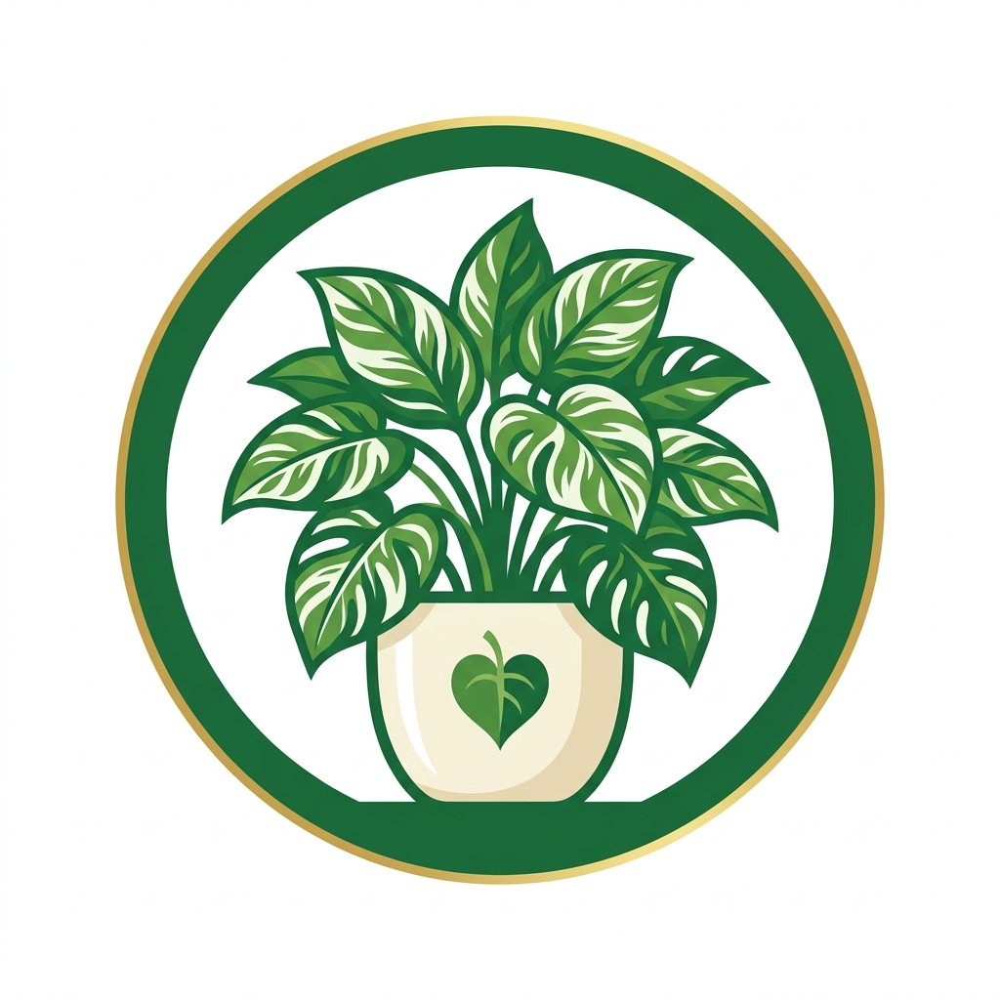

# 🌿 AMABELLEPEAU — Marketplace de Cosmétiques Naturels



**Savons Naturels • Soins • Bien-être**

Marketplace multi-vendeurs de cosmétiques et savons artisanaux naturels, basée à Abidjan, Côte d'Ivoire.

---

## 🏗 Architecture

| Composant | Technologie |
|-----------|------------|
| Frontend | HTML5, CSS3, Vanilla JavaScript |
| Backend / Auth | [Supabase](https://supabase.com) (`uwtbmntwujtcybusxsen`) |
| Paiements | Wave, Orange Money (liens statiques MVP) |
| Messagerie | WhatsApp Catalog |
| Hébergement | [Vercel](https://vercel.com) |
| PWA | Service Worker + Web App Manifest |

## 📁 Structure du Projet

```
amabellepeau/
├── index.html              # 🏠 Page d'accueil
├── catalogue.html          # 📋 Catalogue produits
├── produit.html            # 🧴 Fiche produit détaillée
├── panier.html             # 🛒 Panier
├── checkout.html           # 💳 Paiement (multi-étapes)
├── auth.html               # 🔐 Connexion / Inscription
├── compte.html             # 👤 Espace client (commandes, profil)
├── admin/
│   ├── index.html          # ⚙️ Dashboard administrateur
│   ├── influenceurs.html   # ⭐ Gestion des influenceurs
│   └── commissions.html    # 💰 Suivi des commissions
├── marchand/
│   └── index.html          # 🏪 Dashboard marchand
├── css/
│   └── main.css            # 🎨 Design system complet
├── js/
│   ├── supabase.js         # 🔌 Client Supabase (auth, produits, commandes)
│   ├── cart.js             # 🛒 Gestion panier LocalStorage
│   ├── payments.js         # 💳 Configuration paiements Wave/OM/WhatsApp
│   └── promo.js            # 🎟️ Système codes promo influenceurs
├── assets/
│   └── icons/logo.png      # Logo AMABELLEPEAU
├── supabase-schema.sql     # 📊 Schéma base de données complet
├── manifest.json           # 📱 PWA manifest
├── sw.js                   # ⚡ Service Worker
├── vercel.json             # 🚀 Configuration Vercel
└── .env.example            # 🔑 Variables d'environnement template
```

## 🎯 Fonctionnalités

### Client
- 🛍️ Navigation et recherche de produits
- 🛒 Panier avec règle de marchand unique
- 💳 Checkout multi-étapes (Wave, Orange Money, WhatsApp)
- 🎟️ Application de codes promo influenceurs
- 📦 Suivi de commande en temps réel
- 👤 Espace client (profil, commandes, adresses)
- 📱 PWA installable

### Marchand
- 📊 Dashboard avec statistiques de ventes
- 📦 Gestion des produits et stocks
- 🔔 Notifications de nouvelles commandes
- ✅ Acceptation / rejet des commandes

### Administrateur
- 📊 Dashboard global avec KPIs
- 🏪 Approbation des marchands
- ⭐ **Gestion des influenceurs** — CRUD complet
- 🎟️ **Codes promo** — Création et suivi
- 💰 **Commissions** — Calcul automatique et paiements
- 📋 **Suivi des ventes par code promo** — Nom, téléphone, montant par acheteur
- 🚚 Dispatch des livraisons
- 💳 Suivi des paiements et remboursements

### Système Influenceurs / Affiliés
- 🎟️ Codes promo uniques par influenceur
- 📊 Commission configurable (% par influenceur)
- 🎁 Remise optionnelle pour l'acheteur
- 👤 Tracking des acheteurs (nom, prénom, téléphone)
- 💰 Calcul automatique des commissions
- 💸 Gestion des paiements influenceurs (Wave/OM/Espèces)
- 📈 Rapports et classement des performances

## 🔑 Configuration

### Variables d'environnement
```bash
cp .env.example .env
# Renseigner SUPABASE_ANON_KEY
```

### Base de données Supabase
1. Aller dans le [SQL Editor Supabase](https://supabase.com/dashboard)
2. Coller et exécuter le contenu de `supabase-schema.sql`

### Paiements (MVP — Liens statiques)
| Méthode | Lien |
|---------|------|
| 🌊 Wave | `https://pay.wave.com/mqr-tc/mqr-1cz6t6hdg21tj` |
| 🟠 Orange Money | `https://multi.app.orange-money.com/...` |
| 💬 WhatsApp | `https://wa.me/c/2250799108108` |

## 🚀 Déploiement

### Vercel
```bash
# Installer Vercel CLI
npm i -g vercel

# Déployer
vercel --prod
```

### Développement local
Servir avec n'importe quel serveur statique :
```bash
npx serve .
```

## 💰 Modèle économique

- **Commission** : 15% sur chaque vente (configurable par marchand)
- **Influenceurs** : Commission variable (5-20%) sur les ventes référées
- **Livraison** : Frais de 1 500 XOF (gratuite au-dessus de 15 000 XOF)

## 📞 Contact

- **WhatsApp** : [+225 07 99 10 81 08](https://wa.me/2250799108108)
- **Marque** : AMABELLEPEAU — Savons Naturels
- **Lieu** : Abidjan, Côte d'Ivoire 🇨🇮

---

*Conçu avec 💚 pour la beauté naturelle africaine.*
